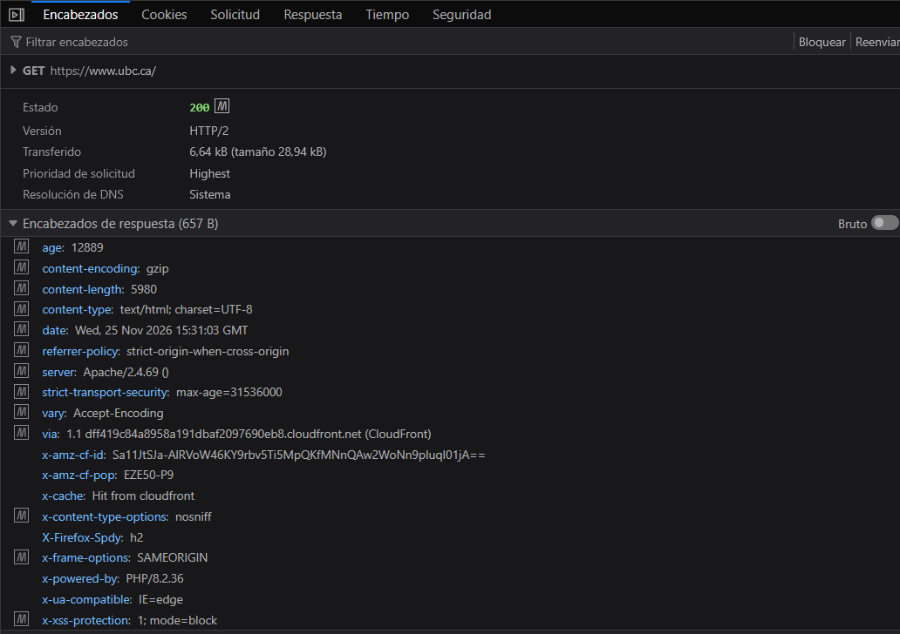

**Cliente:** Universidad de Columbia Británica 
**Aplicación / Entorno:** (`https://www.ubc.ca/`)  
**Ventana de prueba:** 11/11/2026 a 11/11/2026  
**Fecha:** 11/11/2026 | **Clasificación:** Confidencial  
**Elaborado por:** Juan Arones

---

## 1. Resumen Ejecutivo

### 1.1 Objetivo del Análisis
    Ejecución de un análisis pasivo para identificar configuraciones inseguras o exposición innecesaria de información tecnológica.

### 1.2 Nivel de Riesgo
    Bajo

### 1.3 Resultados Clave e Impacto al Negocio
* **Total de hallazgos:** `1` hallazgo (`1` Bajos).
* **Riesgo más importante:** Exposición pública de la versión exacta del software del servidor web Apache/2.4.49 en las cabeceras de respuesta HTTP.
* **Fortalezas observadas:** Correcta implementación de cabeceras de seguridad defensivas en el flujo principal.

### 1.4 Prioridades de Remediación
1. **Prioridad Baja:** Ocultar la versión exacta del servidor web en las cabeceras de respuesta HTTP globales | **Responsable:** A definir por administrador | **Plazo estimado:** 7 a 15 días.

---

## 2. Detalles Técnicos
- ID: **PT-01** 
- Título del Hallazgo: Exposición de versión del servidor web
- Gravedad: Bajo
- CVSS Base: 5.3
- CWE: `CWE-200`
- Activo Afectado: `https://www.ubc.ca/`
- Estado: Abierto

---

## 3. Métricas CVSS

### Puntuación de Severidad del Hallazgo [PT-01]
* **Versión CVSS:** 3.1
* **Puntuación Base:** 5.3
* **Severidad:** bajo
* **Vector CVSS String:** CVSS:3.1/AV:N/AC:L/PR:N/UI:N/S:U/C:L/I:N/A:N

---

## 4. Prueba de Concepto (PoC) detallada paso a paso

### Hallazgo [PT-01]: Exposición de versión del servidor web

#### Descripción de la Vulnerabilidad:
    Durante la inspección pasiva del tráfico HTTP, se detectó que el servidor web incluye en sus respuestas la cabecera "server" revelando tanto la tecnología subyacente como su versión exacta (Apache/2.4.49). Esta configuración por defecto incumple las buenas prácticas, ya que entrega inteligencia útil a posibles atacantes para perfilar el entorno tecnológico sin necesidad de realizar escaneos invasivos.

#### Pasos de Reproducción
1. Abrir el navegador web e ingresar de forma legítima al dominio público dentro del alcance del programa: `https://www.ubc.ca/`.
2. Presionar `F12` para abrir las Herramientas de Desarrollador y seleccionar la pestaña **Red** (*Network*).
3. Recargar la página (`F5`) para capturar el flujo natural de peticiones HTTP y seleccionar la primera petición `GET` correspondiente al documento raíz (`/`).
4. Desplegar el panel **Encabezados** (*Headers*), revisar la sección **Encabezados de respuesta** (*Response Headers*) y verificar el valor expuesto en la cabecera `server`.

#### Evidencia Fotográfica / Registros

---

## 5. Recomendaciones de Remediación
- **Acción Correctiva:** Configurar el servidor web para que no exponga la versión exacta del software en las cabeceras de respuesta. En Apache, esto se logra modificando la directiva `ServerTokens` a `Prod` y `ServerSignature` a `Off` en el archivo de configuración `httpd.conf` o `apache2.conf`.
---

