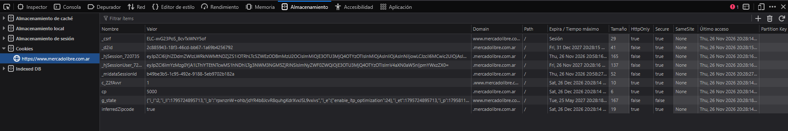
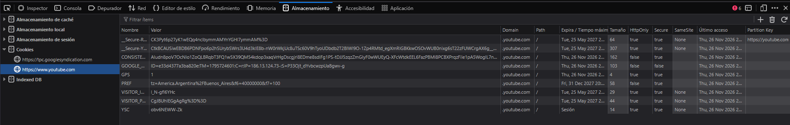

# Objetivo 1: Auditoría de Cookies y Banderas de Seguridad

## Análisis de sitios web
Se analizaron tres sitios web de uso público utilizando el Inspector del navegador. Se buscó identificar la cookie de sesión principal y verificar si contaba con las banderas de seguridad.

**Disney+**: 
    httpOnly: No 
    Secure: No
**MercadoLibre**:
    httpOnly: si 
    Secure: Sí 
**YouTube**:
    httpOnly: Si 
    Secure: Sí

## ¿Qué protege la bandera HttpOnly?
La bandera `HttpOnly` indica al navegador que la cookie no debe ser accesible a través de JavaScript.
Evita que un atacante que logre inyectar código JavaScript en la página pueda robar la cookie de sesión. Si la cookie tiene `HttpOnly`, el script malicioso no puede leerla ni enviarla a un servidor externo, lo que impide que el atacante se haga pasar por el usuario.

## ¿Qué protege la bandera Secure?
La bandera `Secure` indica al navegador que la cookie **solo debe enviarse a través de conexiones cifradas HTTPS**. 
Si la cookie no tiene `Secure`, el navegador la enviará también por HTTP no cifrado. Un atacante en la misma red podría interceptar el tráfico y capturar la cookie de sesión en texto plano. Con esa cookie, el atacante podría secuestrar la sesión del usuario y acceder a su cuenta sin necesidad de conocer la contraseña.

## Análisis de los resultados

*   **Disney+:** Se observó que la cookie de sesión carece de ambas banderas de seguridad (`HttpOnly: false` y `Secure: false`). Esto representa un riesgo alto: por un lado, la falta de `HttpOnly` permite que un ataque XSS robe la cookie; por otro, la falta de `Secure` permite que la cookie viaje por HTTP y sea interceptada por un Man-in-the-Middle. Es una configuración insegura que debería corregirse.

*   **MercadoLibre y YouTube:** Ambos sitios presentan una configuración robusta, con las banderas `HttpOnly` y `Secure` activadas en sus cookies de sesión. Esto demuestra que aplican las buenas prácticas de seguridad recomendadas por la industria.

## Evidencia Fotográfica

**Cookies de Disney+ (HttpOnly: false, Secure: false):**

**Cookies de MercadoLibre (HttpOnly: true, Secure: true):**

**Cookies de YouTube (HttpOnly: true, Secure: true):**
