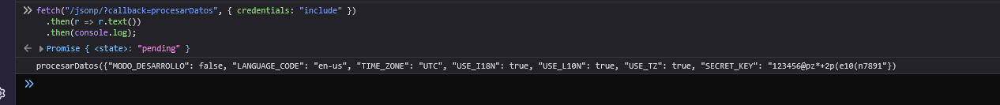

**Cliente:** Software-Seguro
**Aplicación / Entorno:** Laboratorio "Consulta de Multas" (`https://chl-4cf304d5-450e-445b-93c2-a7cf4e8f3bfb-consulta-multas.softwareseguro.com.ar/`)
**Ventana de prueba:** 27/11/2026 a 27/11/2026
**Fecha:** 27/11/2026 | **Clasificación:** Confidencial
**Elaborado por:** Juan Arones

---

## 1. Resumen Ejecutivo

### 1.1 Objetivo del Análisis
Escalar privilegios desde una cuenta de usuario estándar hacia el rol de administrador para acceder a recursos restringidos del sistema "Consulta de Multas".

### 1.2 Nivel de Riesgo
**Alto**

### 1.3 Resultados Clave e Impacto al Negocio
*   **Total de hallazgos:** `1` (Alto)
*   **Riesgo más importante:** Exposición de la clave secreta para firmar tokens JWT. Esto permite a un atacante crear un token falso con permisos de administrador y acceder a información restringida.
*   **Fortalezas observadas:** La cookie de sesión tiene el atributo `HttpOnly` habilitado, lo que dificulta su robo mediante scripts maliciosos (XSS).

### 1.4 Prioridades de Remediación
1. **Prioridad Alta:** Cambiar inmediatamente la clave secreta JWT, dejar de exponerla en el código o en respuestas del servidor, y validar los permisos del usuario siempre desde el backend.
*   **Responsable:** Equipo de Backend y Seguridad | **Plazo estimado:** 1 a 5 días.

---

## 2. Detalles Técnicos

*   ID: **PT-01**
*   Título del Hallazgo: Escalada de Privilegios por Firma JWT Débil/Expuesta
*   Gravedad: Alto
*   CVSS Base: 7.5
*   CWE: `CWE-321` / `CWE-639`
*   Activo Afectado: Cookie `auth` (JWT HS256) y rutas protegidas.
*   Estado: Abierto

---

## 3. Métricas CVSS
*   **Versión CVSS:** 3.1
*   **Puntuación Base:** 7.5
*   **Severidad:** Alto
*   **Vector:** `CVSS:3.1/AV:N/AC:L/PR:N/UI:N/S:U/C:H/I:N/A:N`

---

## 4. Prueba de Concepto (PoC)

### Descripción
La aplicación usa tokens JWT (HS256) guardados en la cookie `auth`. Si un atacante obtiene la clave secreta con la que se firman estos tokens, puede crear uno nuevo modificando el campo `role` a `admin` y el `user_id` al del administrador. Al reemplazar la cookie, el servidor le otorga privilegios de administrador.

### Pasos de Reproducción
1. Iniciar sesión con la cuenta de usuario estándar (`ignacio_123@yopmail.com`).
2. Inspeccionar la cookie `auth` desde las Herramientas de Desarrollador (F12) para ver la estructura del token.
3. Obtener la clave secreta expuesta (`123456@pz*+2p(e10(n7891`).
4. Usar un script en la consola del navegador para generar un nuevo token JWT firmado con esa clave, cambiando los datos a `user_id: 2`, `email: administrador_multas@yopmail.com` y `role: admin`.
5. Reemplazar el valor de la cookie `auth` con el nuevo token generado.
6. Recargar la página. El servidor ahora reconoce al usuario como administrador y muestra el código de resolución del desafío.

### Evidencia

---

## 5. Recomendaciones de Remediación
- **Rotación de Secretos:** Cambiar la clave secreta JWT de inmediato y almacenarla de forma segura (variables de entorno, gestores de secretos), nunca en el código fuente expuesto.
- **Validación en Backend:** Nunca confiar en los datos del token (como el rol) sin antes validarlos contra la base de datos. El backend debe verificar que el usuario realmente tiene los permisos que dice tener.
- **Configuración Segura:** Asegurar que las cookies de sesión tengan los atributos `Secure`, `HttpOnly` y `SameSite` configurados correctamente.