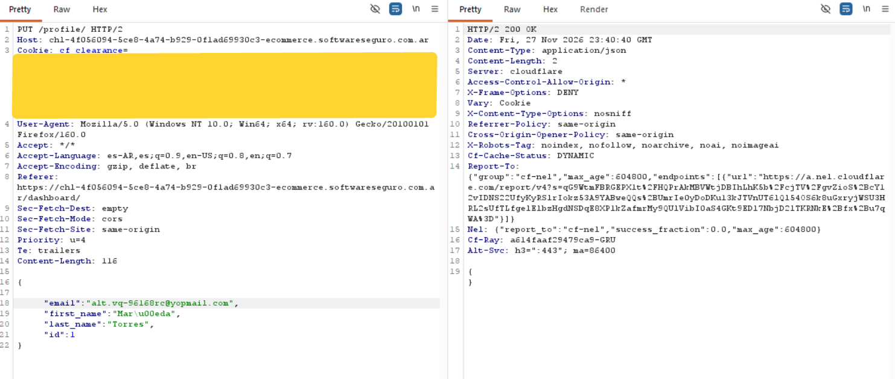

**Cliente:** Software-Seguro
**Aplicación / Entorno:** Laboratorio "Ecommerce" (`https://chl-4f0s6094-5ce8-4a74-b929-0f1ad69930c3-ecommerce.softwareseguro.com.ar/`)
**Ventana de prueba:** 27/11/2026 a 27/11/2026
**Fecha:** 27/11/2026 | **Clasificación:** Confidencial
**Elaborado por:** Juan Arones

---

## 1. Resumen Ejecutivo

### 1.1 Objetivo del Análisis
Realizar una compra no autorizada desde la cuenta de un usuario y con el método de verificación de código, desde otra cuenta aparte. 

### 1.2 Nivel de Riesgo
**Crítico**

### 1.3 Resultados Clave e Impacto al Negocio
*   **Total de hallazgos:** `2` (1 Crítico, 1 Medio).
*   **Riesgo más importante:** Modificación no autorizada de datos de otros usuarios (IDOR + Mass Assignment). Permite a un atacante cambiar el correo electrónico de cualquier usuario, secuestrar su cuenta y evadir la autenticación de dos pasos (2FA).
*   **Fortalezas observadas:** El servidor protege el campo `username` contra modificaciones, lo que demuestra que existe un intento de filtrado de campos, aunque incompleto.

### 1.4 Prioridades de Remediación
1. **Prioridad Crítica:** Implementar validación de permisos a nivel de objeto (verificar que el `id` del token de sesión coincida con el `id` de la petición) y filtrar estrictamente los campos permitidos al actualizar un perfil.
*   **Responsable:** Equipo de Backend y Seguridad | **Plazo estimado:** 1 a 3 días.

---

## 2. Detalles Técnicos

*   ID: **PT-01**
*   Título del Hallazgo: Account Takeover (ATO) mediante Mass Assignment e IDOR en el perfil de usuario.
*   Gravedad: Crítico
*   CVSS Base: 9.1
*   CWE: `CWE-639` (IDOR) / `CWE-915` (Mass Assignment)
*   Activo Afectado: Endpoint de actualización de perfil (Método `PUT`).
*   Estado: Abierto

---

## 3. Métricas CVSS
*   **Versión CVSS:** 3.1
*   **Puntuación Base:** 9.1
*   **Severidad:** Crítica
*   **Vector:** `CVSS:3.1/AV:N/AC:L/PR:L/UI:N/S:U/C:H/I:H/A:N`

---

## 4. Prueba de Concepto (PoC)

### Descripción
La aplicación permite actualizar los datos del perfil mediante una petición `PUT`. El servidor confía en el parámetro `id` enviado en el cuerpo de la petición para identificar al usuario a modificar, en lugar de extraerlo de la sesión autenticada. Además, no filtra el campo `email`, permitiendo inyectar un correo controlado por el atacante.

### Pasos de Reproducción
1. Iniciar sesión con la cuenta en uso (`maria`).
2. Interceptar la petición `GET` que se genera al ver el perfil.
3. Modificar la petición de `GET` a `PUT` y el parámetro `id: 2` por `id: 1` (ID de Juan).
4. Cambiar el valor del campo `email` por uno controlado por el atacante.
5. Eliminar el campo `username` del cuerpo de la petición (el servidor lo rechaza por ser inmutable).
6. Enviar la petición. El servidor responde con `200 OK`, actualizando el correo de Juan.
7. Iniciar sesión en la aplicación con las credenciales de Juan. El código 2FA será enviado al correo del atacante.
8. Ingresar el código recibido, acceder a la cuenta de Juan y completar la compra del producto "Memoria RAM 16GB DDR4".

### Evidencia

*Petición interceptada donde se manipula el `id` del usuario y el campo `email`.*

---

## 5. Recomendaciones de Remediación
- **Validación de Objeto:** El backend debe obtener el ID del usuario a modificar exclusivamente del token de sesión (JWT o cookie), nunca del cuerpo de la petición (Body).
- **Filtrado de Campos (Whitelist):** Implementar un diccionario estricto de campos permitidos para actualizar (ej. solo `first_name`, `last_name`), ignorando cualquier otro campo enviado por el usuario.
- **Validación de Correo:** Si se permite cambiar el correo, exigir la confirmación de la contraseña actual y validar el nuevo correo antes de aplicar el cambio.