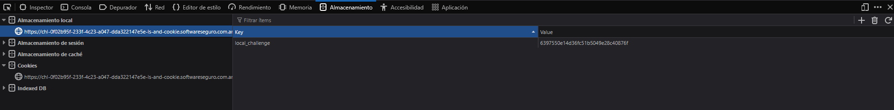
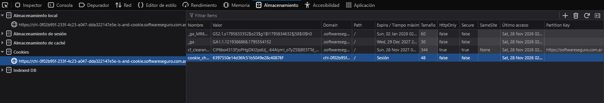

**Cliente:** Software-Seguro
**Aplicación / Entorno:** Laboratorio "Local Storage and Cookie" (`https://.../inspector-challenge/`)
**Ventana de prueba:** 28/11/2026 a 28/11/2026
**Fecha:** 28/11/2026 | **Clasificación:** Confidencial
**Elaborado por:** Juan Arones

---

## 1. Resumen Ejecutivo

### 1.1 Objetivo del Análisis
Superar el desafío modificando el valor de una cookie y el almacenamiento local (localStorage) del navegador para que contengan el hash MD5 de la palabra "hackertech", demostrando la falta de validación del lado del servidor.

### 1.2 Nivel de Riesgo
**Medio**

### 1.3 Resultados Clave e Impacto al Negocio
*   **Total de hallazgos:** `1` (Medio).
*   **Riesgo más importante:** La aplicación valida el estado del desafío basándose únicamente en datos almacenados en el lado del cliente (cookies y localStorage), los cuales son fácilmente manipulables por el usuario.
*   **Fortalezas observadas:** El uso de hashes MD5 para ofuscar el valor esperado, aunque esta ofuscación es débil.

### 1.4 Prioridades de Remediación
1. **Prioridad Media:** Mover la lógica de validación al servidor. El backend debe verificar si el usuario ha completado el desafío, no el frontend.
*   **Responsable:** Equipo de Desarrollo Frontend y Backend | **Plazo estimado:** 3 a 5 días.

---

## 2. Detalles Técnicos

*   **ID:** PT-01
*   **Título del Hallazgo:** Client-Side Security Bypass (Manipulación de Cookies y LocalStorage)
*   **Gravedad:** Medio
*   **CVSS Base:** 5.3
*   **CWE:** `CWE-602` (Client-Side Enforcement of Server-Side Security) / `CWE-565` (Reliance on Cookies without Validation)
*   **Activo Afectado:** Cookies y LocalStorage del navegador.
*   **Estado:** Abierto

---

## 3. Métricas CVSS
*   **Versión CVSS:** 3.1
*   **Puntuación Base:** 5.3
*   **Severidad:** Medio
*   **Vector:** `CVSS:3.1/AV:N/AC:L/PR:N/UI:N/S:U/C:L/I:L/A:N`

---

## 4. Prueba de Concepto (PoC)

### Descripción
El reto indica que para superarlo, el valor de la cookie y del localStorage deben contener el hash MD5 de la palabra "hackertech". Utilizando las herramientas de desarrollador del navegador (F12), un atacante puede inspeccionar y modificar estos valores para inyectar el hash requerido, engañando a la aplicación para que valide el desafío como completado.

### Pasos de Reproducción
1. Obtener el hash MD5 de la palabra "hackertech" (por ejemplo, utilizando una herramienta online como MD5HashGenerator).
2. Abrir las Herramientas de Desarrollador del navegador (F12).
3. Dirigirse a la pestaña **Aplicación (Application)** -> **Almacenamiento Local (Local Storage)**. Crear o modificar una entrada con el hash MD5 obtenido.
4. Dirigirse a la sección **Cookies**. Crear o modificar una cookie para el sitio con el mismo hash MD5.
5. Recargar la página y hacer clic en el botón **"Validar"**.

### Evidencia

---

## 5. Recomendaciones de Remediación
- **Validación en el Servidor:** El servidor debe mantener el estado del progreso del usuario. Al hacer clic en "Validar", el frontend debe enviar la solicitud al backend, y el backend debe verificar si el usuario realmente completó los pasos previos, en lugar de confiar en una cookie o localStorage controlados por el cliente.
- **Uso de Firmas Criptográficas:** Si se debe usar una cookie, esta debe estar firmada criptográficamente (por ejemplo, usando JWT o un HMAC) para detectar cualquier manipulación por parte del usuario.