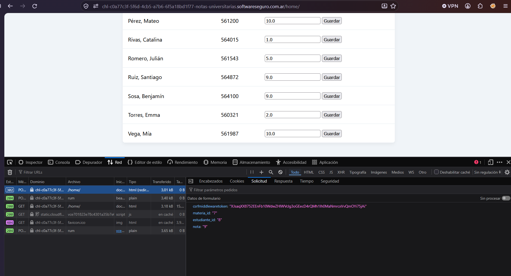

**Cliente:** Softwar-Seguro
**Aplicación / Entorno:** `https://chl-c0a77c3f-5f6d-4cb5-a7b6-6f5a18bd1f77-notas-universitarias.softwareseguro.com.ar/`
**Ventana de prueba:** 26/11/2026 a 26/11/2026
**Fecha:** 26/11/2026 | **Clasificación:** Confidencial
**Elaborado por:** Juan Arones

---

## 1. Resumen Ejecutivo

### 1.1 Objetivo del Análisis
Identificar fallos de seguridad en la plataforma de notas académicas, Comprobar la vulnerabilidad de cambio de Datos de un usuario a otro.

### 1.2 Nivel de Riesgo
Crítico

### 1.3 Resultados Clave
*   **Total de hallazgos:** 2 (1 Crítico, 1 Medio).
*   **Riesgo principal:** Modificación no autorizada de calificaciones a través de la manipulación de parámetros HTTP.
*   **Fortalezas:** Protección CSRF activa y bloqueo de tokens comprometidos.

### 1.4 Prioridades de Remediación
1. **Crítico:** Validar permisos de usuario en el backend al modificar notas.
2. **Medio:** Cambiar credenciales por defecto (`admin:admin`) y desactivar `DEBUG` en producción.

---

## 2. Detalles Técnicos
- ID: **PT-01**
- Título: Modificación no autorizada de calificaciones (Broken Access Control)
- Gravedad: Crítico
- CVSS Base: 9.1
- CWE: `CWE-639`
- Activo Afectado: `/home/` (POST) y `/admin/`
- Estado: Abierto

---

## 3. Métricas CVSS
*   **Versión CVSS:** 3.1
*   **Puntuación Base:** 9.1
*   **Severidad:** Crítica
*   **Vector:** `CVSS:3.1/AV:N/AC:L/PR:L/UI:N/S:U/C:H/I:H/A:N`

---

## 4. Prueba de Concepto (PoC)

### Descripción
El servidor confía en los parámetros enviados por el cliente (`estudiante_id`, `materia_id`, `nota`) sin verificar si el usuario tiene permisos para modificar esa nota. Además, el panel de administración usa credenciales por defecto.

### Pasos de Reproducción
1. Acceder a `/admin/` con las credenciales `admin` / `admin`.
2. Ir a `/home/` (vista de notas).
3. Abrir Herramientas de Desarrollador (F12) -> pestaña **Red**.
4. Interceptar la petición POST al presionar "Guardar" en la nota de un alumno.
5. Modificar los parámetros `estudiante_id` y `nota`.
6. Enviar la petición. El servidor responde con `302` y guarda el cambio.

### Evidencia

 *(Petición POST interceptada con parámetros modificados)*

---

## 5. Recomendaciones de Remediación
- **Control de Acceso:** Validar en el backend que solo los profesores puedan modificar notas y solo de sus materias.
- **Credenciales:** Forzar el cambio de contraseña del admin y eliminar credenciales por defecto.
- **Configuración:** Establecer `DEBUG = False` en Django para no exponer rutas internas en errores.