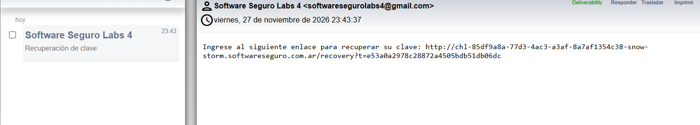
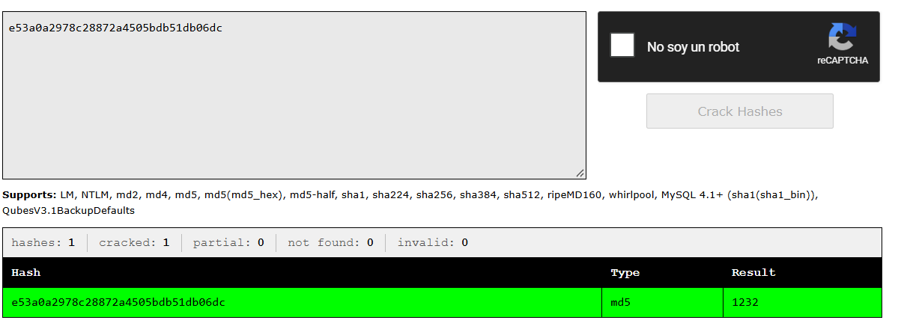

**Cliente:** Software-Seguro
**Aplicación / Entorno:** Laboratorio "Snow Storm" (`https://chl-85df9a8a-77d3-4ac3-a3af-8a7af1354c38-snow-storm.softwareseguro.com.ar/`)
**Ventana de prueba:** 28/11/2026 a 28/11/2026
**Fecha:** 28/11/2026 | **Clasificación:** Confidencial
**Elaborado por:** Juan Arones

---

## 1. Resumen Ejecutivo

### 1.1 Objetivo del Análisis
Tomar el control de la cuenta del usuario "Juan Pérez" para modificar su perfil y obtener el hash de resolución del laboratorio, explotando debilidades en el mecanismo de recuperación de contraseñas.

### 1.2 Nivel de Riesgo
**Crítico**

### 1.3 Resultados Clave e Impacto al Negocio
*   **Total de hallazgos:** `1` (Crítico).
*   **Riesgo más importante:** Generación de tokens de recuperación de contraseña predecibles basados en hashes MD5 de números secuenciales. Esto permite a un atacante adivinar el token de cualquier usuario y tomar el control de su cuenta.
*   **Fortalezas observadas:** El sistema implementa protección CSRF y utiliza sesiones para la autenticación.

### 1.4 Prioridades de Remediación
1. **Prioridad Crítica:** Implementar la generación de tokens de recuperación utilizando generadores de números pseudoaleatorios criptográficamente seguros (CSPRNG). Los tokens deben ser únicos, impredecibles y tener una vida útil corta.
*   **Responsable:** Equipo de Backend y Seguridad | **Plazo estimado:** 1 a 3 días.

---

## 2. Detalles Técnicos

*   **ID:** PT-01
*   **Título del Hallazgo:** Vulnerabilidad en recuperación de contraseña.
*   **Gravedad:** Crítico
*   **CVSS Base:** 9.8
*   **CWE:** `CWE-330` (Use of Insufficiently Random Values) / `CWE-640` (Weak Password Recovery Mechanism)
*   **Activo Afectado:** Endpoint de recuperación de contraseña (`/recovery/?t=<token>`).
*   **Estado:** Abierto

---

## 3. Métricas CVSS
*   **Versión CVSS:** 3.1
*   **Puntuación Base:** 9.8
*   **Severidad:** Crítica
*   **Vector:** `CVSS:3.1/AV:N/AC:L/PR:N/UI:N/S:U/C:H/I:H/A:H`

---

## 4. Prueba de Concepto (PoC)

### Descripción
El sistema de recuperación de contraseña genera un token de reseteo aplicando un hash MD5 a un número entero secuencial. Al solicitar múltiples tokens para una cuenta controlada, se observa que los valores devueltos son hashes MD5 de números consecutivos (ej. 2424, 2425, 2426). Un atacante puede calcular los hashes de los números cercanos al token de la víctima y probarlos en el endpoint de recuperación hasta dar con el correcto, permitiendo el cambio de contraseña de la víctima sin acceso a su correo.

### Pasos de Reproducción
1. Solicitar la recuperación de contraseña para una cuenta propia (ej. `carlos.ruiz@hacklab.com`) y capturar el token recibido por correo.
2. Identificar el valor numérico que generó dicho token (utilizando herramientas de cracking de hashes como CrackStation).
3. Solicitar la recuperación de contraseña para la cuenta de la víctima (`juan.perez@hacklab.com`) y generar los hashes MD5 de los números cercanos al obtenido en el paso 2 (sumando y restando un rango).
4. Probar cada token generado en la URL de recuperación (`/recovery/?t=<token>`). El token que no devuelva el formulario de solicitud de email es el válido para la víctima.
5. Ingresar al formulario de cambio de contraseña con el token válido y establecer una nueva clave.
6. Iniciar sesión con las credenciales de la víctima, modificar su nombre a "Soy un idiota" y obtener el hash de resolución.

### Evidencia

*Correo electrónico recibido con el enlace de recuperación de contraseña que contiene el token MD5.*

*Se observa cómo el token de recuperación (MD5) es reversado utilizando CrackStation, revelando que corresponde al número secuencial 1232.*

---

## 5. Recomendaciones de Remediación
- **Generación de Tokens Segura:** Reemplazar la generación actual de tokens (MD5 de números secuenciales) por el uso de la librería para generar cadenas aleatorias criptográficamente seguras.
- **Expiración de Tokens:** Asegurar que los tokens de recuperación tengan una validez corta y sean de un solo uso.
- **Validación de Solicitud:** Implementar un mecanismo que invalide el token después de su uso o después de un número determinado de intentos fallidos.