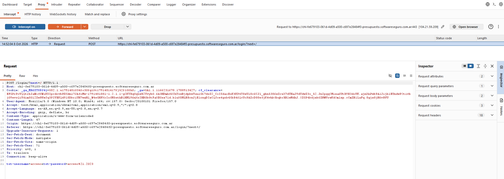
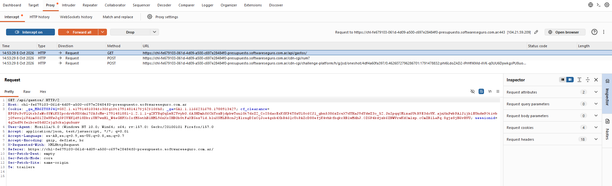

# Objetivo 1: Man-in-the-Middle Local (Configuración y Certificado CA)

**Laboratorio usado:** Presupuesto
El proceso que se interceptó es el inicio de sesión usando credenciales válidas. Después de autenticarse, muestra el panel con el presupuesto general de la cuenta ingresada.

- **Herramienta:** Burp Suite Community Edition
- **Proxy:** 127.0.0.1:8080
- **Certificado CA de Burp:** instalado en el navegador (Firefox)

---

## Endpoint 1: Autenticación (Login)

- **Método:** POST
- **Ruta:** /login/?next=/
- **Parámetros(body):**
  - `txt-username`: nombre de usuario
  - `txt-password`: contraseña del usuario
- **Qué hace?:** Autentica al usuario contra el servidor. Valida las credenciales 
  recibidas; si son correctas crea una sesión y redirige a la ruta indicada. Si son incorrectas, devuelve la página de login con un mensaje de error.

---

## Endpoint 2: API de gastos

- **Método:** GET
- **Ruta:** /api/gastos/
- **Headers importantes:**
  - `Accept: application/json, text/javascript, */*; q=0.01` = Indica que prefiere la respuesta en JSON.
  - `X-Requested-With: XMLHttpRequest` = petición AJAX (fetch/XHR)
  - `Cookie: sessionid=...` = sesión creada tras el login
- **Qué hace?:** Devuelve la lista de gastos del usuario autenticado en formato JSON. El servidor identifica al usuario por la cookie sessionid. Se invoca automáticamente al entrar a la página principal del lab, para poblar la tabla de gastos.

---

## Conclusión
Se logró configurar un entorno MITM local con Burp Suite, interceptar peticiones en vuelo del laboratorio "Presupuesto" y mapear dos endpoints clave: la autenticación (`POST /login/`) y la API de gastos (`GET /api/gastos/`).