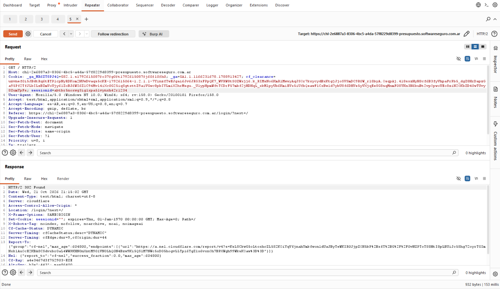
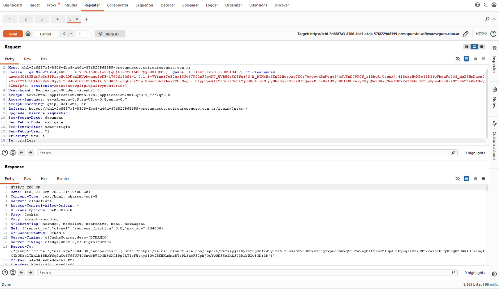

# Objetivo 2: Manipulación Manual de Peticiones (Módulo Repeater)

**Herramienta:** Burp Suite Community Edition (Módulo Repeater)  
**Laboratorio:** Presupuesto  
**Petición base utilizada:** `GET /`

---

## 1. Procedimiento General
1. Se localizó una petición legítima y autenticada en el historial del proxy.
2. Se envió la solicitud al módulo Repeater.
3. Desde allí se realizaron pruebas de reenvío y modificación manual de parámetros para analizar la respuesta del servidor.

---

## 2. Pruebas Realizadas

### Prueba 1
Primero envio la petición modificando la línea de código que contiene la Cookie.

* **Modificación:** Se alteró el valor de la cabecera `Cookie: sessionid=...` ingresando un identificador inválido.
* **Respuesta del Servidor:** `HTTP/2 302 Found`
* **Resultado:** El backend detecta que la sesión no es válida, frena el acceso a la vista protegida y redirige automáticamente al usuario al formulario de inicio de sesión.

---

### Prueba 2
Enviamos la petición modificando una cabecera secundaria para comprobar que el sistema procesa correctamente las solicitudes autorizadas.

* **Modificación:** Se ajustó el valor de la cabecera `User-Agent` manteniendo intacta la cookie de sesión válida.
* **Respuesta del Servidor:** `HTTP/2 200 OK` 
* **Resultado:** El servidor procesa la solicitud de forma exitosa y devuelve la vista solicitada, demostrando que la autenticación es correcta y el flujo funciona de manera esperada.

---

## Conclusión
El uso del módulo Repeater permitió aislar y modificar peticiones HTTP de forma controlada. Por un lado, se confirmó que el sistema responde de manera exitosa ante solicitudes legítimas (`200 OK`), y por otro, se verificó la efectividad de los controles de seguridad al rechazar de forma inmediata sesiones alteradas o falsas (`302 Found`).